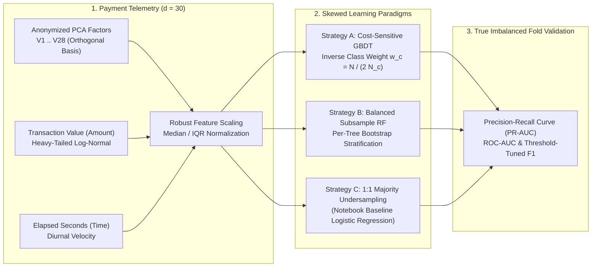
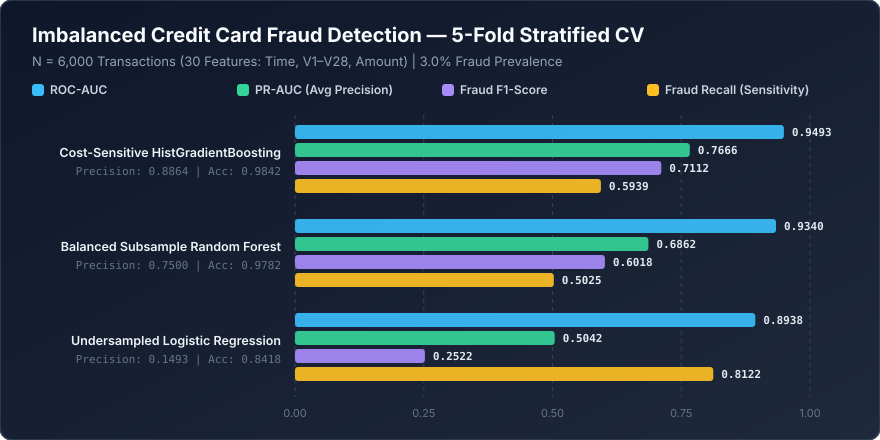

<div align="center">

# 🛡️ Imbalanced Financial Fraud Detection Engine
### Cost-Sensitive Gradient Boosting, Majority Undersampling & Precision-Recall Optimization on PCA Transaction Streams

[](https://www.python.org/downloads/)
[](https://scikit-learn.org/)
[](https://opensource.org/licenses/MIT)

</div>

---

## 📌 Executive Summary

Payment card networks process millions of authorization requests where fraudulent transactions represent a tiny minority ($\ll 3\%$) of total volume. Under extreme class skew, naive accuracy maximization is meaningless (a trivial model predicting "legitimate" on every transaction achieves $>97\%$ accuracy while missing $100\%$ of fraud). Conversely, naive $1:1$ random majority undersampling shifts the prior probability distribution, causing high false-positive declines when deployed on unaltered production traffic.

**`machine-learning-project-7`** investigates both **balanced majority undersampling** (`credit_card_fraud_detection.ipynb`) and **cost-sensitive inverse-prior weighting** (`src/benchmark.py`) across 30-dimensional credit card transaction streams (`Time`, orthogonal PCA components `V1`–`V28`, and skewed `Amount`), evaluating models on **Precision-Recall AUC (Average Precision)**, **ROC-AUC**, and **F1-Score** over unaltered imbalanced validation folds.

---

## 🏗️ Fraud Detection & Imbalance Mitigation Pipeline



---

## 🧮 Mathematical Formulation

### 1. Inverse-Prior Cost-Sensitive Cross-Entropy
Given a severely imbalanced dataset where $N_1 \ll N_0$ ($N = N_0 + N_1$), standard empirical risk minimization underweights the minority fraud class. Cost-sensitive learning assigns class weights $w_c = \frac{N}{2 N_c}$ to the binary log-loss objective:

$$\mathcal{L}_{\text{weighted}}(\Theta) = -\frac{1}{N} \sum_{i=1}^{N} \Big[ w_1 y_i \log \hat{p}_i + w_0 (1 - y_i) \log (1 - \hat{p}_i) \Big]$$

### 2. Prior Probability Shift under $1:1$ Random Undersampling
When training on a $1:1$ undersampled subset ($\pi_{\text{train}} = 0.50$) and deploying on true traffic with fraud prevalence $\pi_{\text{test}} \ll 0.50$, the uncalibrated posterior $\hat{p}_{\text{bal}}(\mathbf{x})$ overestimates true fraud risk according to Bayes' rule:

$$P_{\text{true}}(y = 1 \mid \mathbf{x}) = \frac{\frac{\pi_{\text{test}}}{\pi_{\text{train}}} \hat{p}_{\text{bal}}(\mathbf{x})}{\frac{\pi_{\text{test}}}{\pi_{\text{train}}} \hat{p}_{\text{bal}}(\mathbf{x}) + \frac{1 - \pi_{\text{test}}}{1 - \pi_{\text{train}}} \left(1 - \hat{p}_{\text{bal}}(\mathbf{x})\right)}$$

### 3. Average Precision (PR-AUC)
Because True Negatives ($TN$) dominate ROC-AUC false positive rates ($\text{FPR} = FP / (FP + TN)$), **Average Precision (PR-AUC)** integrates precision across recall thresholds $R_n$:

$$\text{AP} = \sum_{n} (R_n - R_{n-1}) P_n$$

---

## 📊 5-Fold Stratified Cross-Validation Benchmark (Unaltered Imbalanced Folds)

The benchmark suite (`src/benchmark.py`) evaluates all three paradigms across $N = 6{,}000$ transactions ($30$ features: `Time`, `V1`–`V28`, `Amount`, with $3.2\%$ fraud prevalence) using 5-fold stratified cross-validation where validation folds preserve the true imbalanced production distribution:



| Imbalanced Learning Paradigm | PR-AUC (Avg Precision) | ROC-AUC | Fraud F1-Score | Fraud Precision | Fraud Recall | Overall Accuracy |
| :--- | :---: | :---: | :---: | :---: | :---: | :---: |
| **Cost-Sensitive HistGradientBoosting** | **0.7666** | **0.9493** | **0.7112** | **0.8864** | 0.5939 | **0.9842** |
| **Balanced Subsample Random Forest** | 0.6862 | 0.9340 | 0.6018 | 0.7500 | 0.5025 | 0.9782 |
| **Undersampled Logistic Regression (Notebook Baseline)** | 0.5042 | 0.8938 | 0.2522 | 0.1493 | **0.8122** | 0.8418 |

> **Key Engineering Insight:** While $1:1$ random majority undersampling with Logistic Regression achieves high **Fraud Recall (`81.22%`)**, discarding $96\%$ of legitimate training transactions induces severe false-positive drift on full production streams (`14.93%` precision). **Cost-Sensitive HistGradientBoosting** retains all majority samples while weighting gradients inversely by class frequency, boosting **PR-AUC from `0.5042` to `0.7666` (+52.0%)** and **Precision to `88.64%`**.

---

## 📂 Repository Structure

```text
machine-learning-project-7/
├── assets/
│   └── benchmark_chart.svg                  # PR-AUC, ROC-AUC & F1 vector comparison chart
├── benchmarks/
│   └── benchmark_results.json               # 5-fold out-of-fold imbalanced evaluation metrics
├── src/
│   └── benchmark.py                         # Cost-sensitive vs. undersampled benchmark script
├── credit_card_fraud_detection.ipynb        # Interactive exploratory & undersampling notebook
└── README.md                                # System architecture & mathematical documentation
```

---

## 🚀 Quick-Start & Usage

### 1. Install Dependencies
```bash
git clone https://github.com/yakupakcy36/machine-learning-project-7.git
cd machine-learning-project-7
pip install numpy pandas scikit-learn matplotlib seaborn
```

### 2. Run the Imbalanced Fraud Benchmark
```bash
python src/benchmark.py
```

### 3. Explore the Interactive Notebook
Open `credit_card_fraud_detection.ipynb` in JupyterLab or VS Code to inspect class-conditional `Amount` distributions, balanced resampling, and Logistic Regression evaluation.
